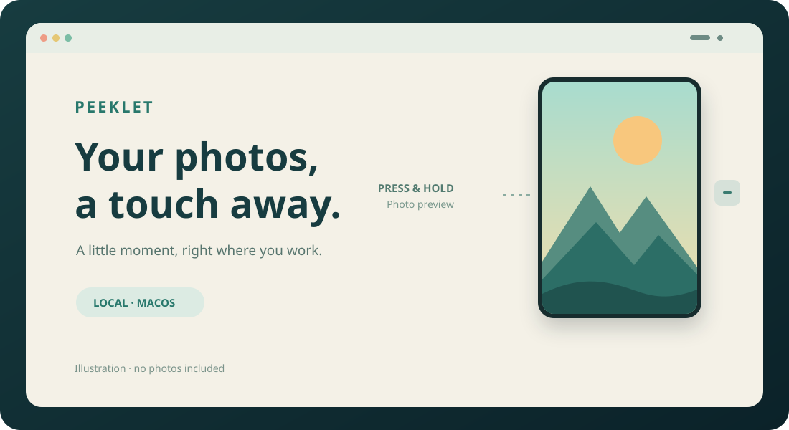

# Peeklet

**Your photos, a touch away.**

A small, local-only floating photo viewer for macOS.



Peeklet keeps a small floating control on your desktop. Press and hold it to briefly see a photo you choose; release to hide the preview. It starts with an empty library and works without an account or network access.

## Features

- **Quick preview:** hold the control for about 0.16 seconds to show the selected image. Release or move the pointer away to hide it.
- **Small and movable:** drag the control to a comfortable position. The default control is 36 × 36 points; 24 × 24 and 44 × 44 options are also available.
- **Your own images:** import up to 30 JPEG, PNG, HEIC, or TIFF files. Scroll over the control or select a photo in the menu to switch images.
- **Adjustable preview:** choose 150 × 225, 180 × 270, or 230 × 345 points. The whole image is fitted inside the preview.
- **Designed for focus:** the preview uses a nonactivating panel and does not request keyboard focus. Menus and the file picker may activate the app.
- **Local by design:** there are no accounts, analytics, or network entitlements. Imported copies remain in the app's sandboxed local storage.

Peeklet works with ordinary macOS Spaces and fullscreen windows. Some exclusive fullscreen apps, protected content, and system screens may appear above it. The app does not prevent screenshots, recordings, or someone looking at your screen.

## Get started

1. Build Peeklet as described below and open `.build/Peeklet.app`.
2. Click the Peeklet menu bar icon, or right-click the small floating control, and choose **Add Photos...**. Select the images you want to use. Each file may be up to 50 MiB and 100 megapixels.
3. Press and hold the control to show a photo. Release to hide it. Scroll over the control to switch photos, or drag it to move it.
4. Use the menu to adjust sizes or change its appearance. Opening the app again restores the control to the upper-right corner.

Use **Remove Current Photo...** or **Remove All Photos...** to remove imported copies. Peeklet does not modify or delete the original files. See [PRIVACY.md](PRIVACY.md) for the details and limitations.

## Build from source

You need macOS 13 or later and Apple's Xcode Command Line Tools. No third-party packages are required.

```bash
git clone https://github.com/mmingzhang77/peeklet.git
cd peeklet
bash build.sh
```

The result is `.build/Peeklet.app`. The default build targets the current Mac's architecture. To build a universal app for Apple Silicon and Intel:

```bash
PEEKLET_ARCH=universal bash build.sh
```

To run the synthetic-image self-tests:

```bash
.build/Peeklet.app/Contents/MacOS/Peeklet --self-test
```

The local build is ad-hoc signed and is **not notarized** with an Apple Developer ID. macOS may warn about a downloaded binary from an unidentified developer. Building from the source you review is an alternative; do not disable system-wide security protections to run an app.

## Privacy and limitations

Peeklet stores resized PNG copies inside its app sandbox, using generated identifiers instead of original filenames. The import process does not retain source EXIF or GPS metadata. Your original files are untouched. Copies are local files, not an encrypted vault; system backups, screen recording, screenshots, and cloud-backed locations are outside Peeklet's control. See [PRIVACY.md](PRIVACY.md).

Peeklet does not require Accessibility, screen recording, camera, or microphone access and does not install a login item.

## Contributing and license

Please read [CONTRIBUTING.md](CONTRIBUTING.md) and [SECURITY.md](SECURITY.md). The source code is available under the [MIT License](LICENSE).
